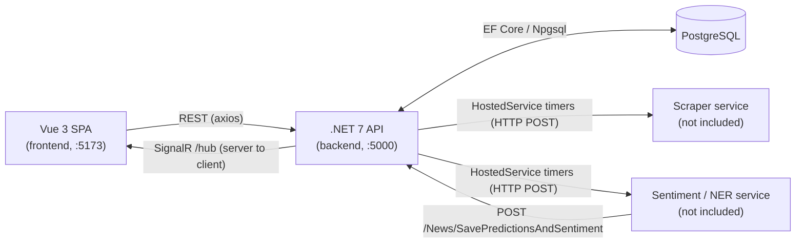

# News Sentiment Dashboard

[Türkçe](README.tr.md)

A small web application for managing news sources and showing per-article sentiment results live in the browser. It consists of an ASP.NET Core (.NET 7) API with PostgreSQL storage and SignalR push, and a Vue 3 single-page frontend. The example news domain is financial/crypto news.

**Status: research prototype (2023). It was never used in production and has no automated tests.** No accuracy or performance claims are made.

This repository contains the web application only (backend and frontend). The other components of the original project are not included in this repository. Because of that, the full pipeline cannot run from this repo alone (see [What works without the external services](#what-works-without-the-external-services)).

## Architecture



Stack: .NET 7, ASP.NET Core Web API, EF Core 7 + Npgsql, SignalR, Swagger; Vue 3, Vite, PrimeVue, Pinia, axios, `@microsoft/signalr`.

## Screens

| Route | What it does |
|---|---|
| `/` (Home) | CRUD table of news sources (title, site URL, RSS URL, XPath, SPA flag, active flag). Buttons fill the backend's in-memory work queues: "RSS Kuyruk Oluştur" (RSS queue), "Haber Çekme Kuyruk Oluştur" (content-fetch queue), "NER-Sentiment Kuyruk Oluştur" (analysis queue), "Kuyruk Temizle" (clear queues). |
| `/sentiment` | Table of stored sentiment results (title, label, score, URL). Loads existing rows over REST, then prepends new rows as they arrive over SignalR. |

Some UI labels are in Turkish (original language of the prototype).

## API endpoints

Swagger UI is available in the Development environment at `/swagger`. Details in [docs/api.md](docs/api.md).

| Method | Path | Purpose |
|---|---|---|
| GET / POST / PATCH | `/NewsSource` | List, create, update news sources |
| DELETE | `/NewsSource/{id}` | Delete a news source |
| GET | `/News` | List stored articles |
| GET | `/News/Sentiments` | List stored sentiment rows (with article) |
| GET | `/News/AggregatorSource` | Queue all news sources for RSS fetching |
| GET | `/News/AggregatorNews` | Queue articles whose content is still `-` for content fetching |
| GET | `/News/PredictionQueue` | Queue articles that have content but no analysis yet |
| GET | `/News/ClearQueue` | Empty all three queues |
| POST | `/News`, `/News/AddRange` | Insert one / many articles |
| PATCH | `/News/UpdateContent` | Set an article's content |
| POST | `/News/SavePredictionsAndSentiment` | Store analysis result, then broadcast it over SignalR |
| WS | `/hub` | SignalR hub; event `Sentiment` |

## How the SignalR flow works

1. The `/sentiment` page opens a WebSocket connection to `/hub` (negotiation skipped, WebSocket transport forced) and registers a handler for the `Sentiment` event.
2. When the analysis service posts a result to `POST /News/SavePredictionsAndSentiment`, the controller writes `Predictions` and `Sentiments` rows, reloads the sentiment row together with its article, and calls `IHubContext<SentimentHub, IClient>.Clients.All.Sentiment(...)`.
3. Every connected browser receives the row and prepends it to the table.

Traffic is one-way (server to client). The hub has no methods, no groups and no authentication.

Queues and timers: the buttons on the Home page fill static in-memory lists (`NewsSourcesList`). Three `IHostedService` timers (every 30 s, 10 s, 10 s) drain those lists by POSTing to the external services. The lists are lost on restart.

## Setup

Prerequisites: .NET 7 SDK, Node.js 18+, Docker (for PostgreSQL), and the EF tool (`dotnet tool install --global dotnet-ef --version 7.*`).

```bash
# 1. Configuration
cp .env.example .env            # edit POSTGRES_PASSWORD (and the matching connection string)

# 2. PostgreSQL (the only service in docker-compose.yml)
docker compose up -d

# 3. Create the schema from the EF migrations
cd backend
# PowerShell: $env:ConnectionStrings__postgres = "Host=localhost;Port=5432;Database=newsdb;Username=postgres;Password=<your password>"
export ConnectionStrings__postgres="Host=localhost;Port=5432;Database=newsdb;Username=postgres;Password=<your password>"
dotnet ef database update

# 4. Run the API (http://localhost:5000, Swagger at /swagger)
dotnet run --launch-profile http

# 5. Run the frontend in a second terminal (http://localhost:5173)
cd frontend
npm install
npm run dev
```

Notes:
- The connection string is read only from configuration (`ConnectionStrings:postgres`): the environment variable `ConnectionStrings__postgres`, `dotnet user-secrets`, or a git-ignored `backend/appsettings.Local.json` (template: `backend/appsettings.Example.json`). The app refuses to start without it.
- The frontend reads the API address from `VITE_BACKEND_URL` (default `http://localhost:5000`); set it in `frontend/.env.local` if needed. The backend CORS policy accepts any origin.
- The application does not apply migrations on startup; run `dotnet ef database update` yourself. There are four migrations (2023-05-27 to 2023-05-31) in `backend/Migrations`.
- The original project used Microsoft Tye for orchestration; it is not needed here and its config file is not included.

### What works without the external services

Expected to work (verified only by compiling, see Verification):
- Source CRUD on the Home page and in Swagger.
- Queue endpoints (they only fill the in-memory lists).
- Manually inserting articles (`POST /News/AddRange`) and results (`POST /News/SavePredictionsAndSentiment`); the latter updates the `/sentiment` page live, which is a way to try the SignalR path without the analysis service (see [docs/api.md](docs/api.md)).

Does not work: automatic RSS fetching, article-content fetching and sentiment/entity analysis. The hosted services POST to a scraper at `Services:Collector` (default `http://127.0.0.1:80`) and an analysis service at `Services:Prediction` (default `http://127.0.0.1:12000`). Without them, each timer tick with a non-empty queue logs an error and nothing is processed. Those services are not part of this repository; their request/response contract is only what the backend code shows.

## Known limits

- **Deleting from a list while iterating it (fixed).** The three hosted services removed items from the queue list inside a `foreach` over that same list, which throws on the next iteration; the exception was swallowed by an empty `catch`, so in practice only one item was processed per timer tick. They now iterate over a snapshot (`.ToList()`) and log exceptions instead of swallowing them. Not run against live services.
- **Wrong list removed in the analysis timer (fixed).** `NewsContentPredictHostedService` iterated `NotPredictedNews` but removed from `News`. It now removes from `NotPredictedNews`, so processed items are no longer re-sent every tick. Not run against live services.
- A request that keeps failing stays in its queue and is retried each tick (the loop aborts on the first exception). There is no retry limit, back-off or dead-letter handling.
- Queues are static in-memory lists, not thread-safe, and lost on restart. A sturdier design would use a persistent queue or a status column plus `BackgroundService`/`Channel<T>`.
- Processing is manually triggered: nothing runs unless someone clicks the queue buttons.
- No authentication or authorization anywhere (no `[Authorize]`, the hub is open); CORS allows any origin with credentials. Do not expose it to a network you do not control.
- Controllers swallow exceptions and return `false` without logging.
- `DELETE /News/{id}` actually deletes the **news source** with that id (copy-paste slip in `NewsController`); left unchanged.
- `SavePredictionsAndSentiment` stores only the first `ner_btc` result list and ignores `ner_fin`; it throws if `ner_btc` is empty.
- The `Coins` table and the Coin/News relation exist in the schema but nothing writes to them. The `Services/*Repository` classes are not registered or used.
- The timers create a new `HttpClient` per item.
- `UseHttpsRedirection` is enabled while the default profile listens on HTTP only (harmless warning).
- No tests, no CI. Runtime behaviour was not verified.
- Cleanup done for publication: the hard-coded database connection string was removed from the source and replaced by configuration; the Vite config used to embed the whole build environment into the bundle (`process.env`) and `main.js` logged it, now only the API address is exposed. Unused template files (sample controller, sample Vue components, counter store) were removed.

## Verification

- `dotnet build` (backend): succeeded, 0 errors (38 nullable-reference warnings from the original code).
- `npm install && npm run build` (frontend): succeeded; Vite warns about a chunk over 500 kB. `npm install` reports `npm audit` advisories for the 2023 dependency versions; they were not addressed.
- Not done: connecting to a database, running the API or the frontend, applying migrations, calling external services.

## Layout

```
backend/    ASP.NET Core API (Controllers, Hubs, HostedServices, Models, Migrations, Services)
frontend/   Vue 3 + Vite SPA
docs/       API and SignalR notes
docker-compose.yml   PostgreSQL only
.env.example         configuration template
```

## License

MIT. See [LICENSE](LICENSE).
