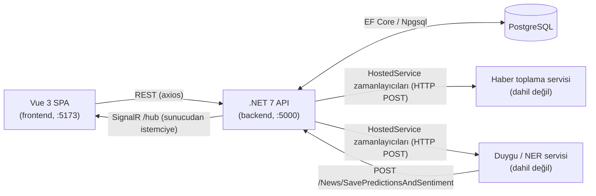

# Haber Duygu Paneli (News Sentiment Dashboard)

[English](README.md)

Haber kaynaklarını yönetmeye ve haber başına duygu sonuçlarını tarayıcıda canlı göstermeye yarayan küçük bir web uygulaması. PostgreSQL depolu ve SignalR ile anlık bildirim yapan bir ASP.NET Core (.NET 7) API ile Vue 3 tek sayfa arayüzünden oluşur. Örnek alan finans/kripto haberleridir.

**Durum: araştırma prototipi (2023). Üretimde kullanılmadı, otomatik test yok.** Doğruluk veya performans iddiası yoktur.

Bu depo yalnızca web uygulamasını (backend ve frontend) içerir. Orijinal projenin diğer bileşenleri bu depoya dahil değildir. Bu yüzden tam akış yalnızca bu depoyla çalışmaz (bkz. [Harici servisler olmadan ne çalışır](#harici-servisler-olmadan-ne-çalışır)).

## Mimari



Teknolojiler: .NET 7, ASP.NET Core Web API, EF Core 7 + Npgsql, SignalR, Swagger; Vue 3, Vite, PrimeVue, Pinia, axios, `@microsoft/signalr`.

## Ekranlar

| Rota | Ne yapar |
|---|---|
| `/` (Home) | Haber kaynakları için CRUD tablosu (başlık, site URL, RSS URL, XPath, SPA ve aktif bayrakları). Düğmeler backend'deki bellek içi iş kuyruklarını doldurur: "RSS Kuyruk Oluştur", "Haber Çekme Kuyruk Oluştur", "NER-Sentiment Kuyruk Oluştur", "Kuyruk Temizle". |
| `/sentiment` | Kayıtlı duygu sonuçları tablosu (başlık, etiket, skor, URL). Mevcut satırları REST ile yükler, yenileri SignalR ile gelince en üste ekler. |

## API uç noktaları

Development ortamında Swagger arayüzü `/swagger` adresindedir. Ayrıntı: [docs/api.md](docs/api.md) (İngilizce).

| Metot | Yol | Amaç |
|---|---|---|
| GET / POST / PATCH | `/NewsSource` | Kaynakları listele, ekle, güncelle |
| DELETE | `/NewsSource/{id}` | Kaynağı sil |
| GET | `/News` | Kayıtlı haberler |
| GET | `/News/Sentiments` | Kayıtlı duygu satırları (haberiyle) |
| GET | `/News/AggregatorSource` | Tüm kaynakları RSS kuyruğuna al |
| GET | `/News/AggregatorNews` | İçeriği hâlâ `-` olan haberleri içerik kuyruğuna al |
| GET | `/News/PredictionQueue` | İçeriği olup analizi olmayan haberleri analiz kuyruğuna al |
| GET | `/News/ClearQueue` | Üç kuyruğu boşalt |
| POST | `/News`, `/News/AddRange` | Bir / çok haber ekle |
| PATCH | `/News/UpdateContent` | Haber içeriğini yaz |
| POST | `/News/SavePredictionsAndSentiment` | Analiz sonucunu kaydet, SignalR ile yayınla |
| WS | `/hub` | SignalR hub'ı; olay: `Sentiment` |

## SignalR akışı nasıl işler

1. `/sentiment` sayfası `/hub` adresine WebSocket bağlantısı açar (negotiation atlanır, WebSocket taşıması zorlanır) ve `Sentiment` olayına bir işleyici bağlar.
2. Analiz servisi `POST /News/SavePredictionsAndSentiment` ile sonuç gönderince controller `Predictions` ve `Sentiments` satırlarını yazar, duygu satırını haberiyle birlikte yeniden okur ve `IHubContext<SentimentHub, IClient>.Clients.All.Sentiment(...)` çağırır.
3. Bağlı her tarayıcı satırı alır ve tablonun başına ekler.

Trafik tek yönlüdür (sunucudan istemciye). Hub'da metot, grup veya kimlik doğrulama yoktur.

Kuyruklar ve zamanlayıcılar: Home sayfasındaki düğmeler statik bellek içi listeleri (`NewsSourcesList`) doldurur. Üç `IHostedService` zamanlayıcısı (30 sn, 10 sn, 10 sn) bu listeleri harici servislere POST ederek boşaltır. Liste yeniden başlatmada kaybolur.

## Kurulum

Gereksinimler: .NET 7 SDK, Node.js 18+, Docker (PostgreSQL için), EF aracı (`dotnet tool install --global dotnet-ef --version 7.*`).

```bash
# 1. Yapılandırma
cp .env.example .env            # POSTGRES_PASSWORD'u ve eşleşen bağlantı dizesini düzenleyin

# 2. PostgreSQL (docker-compose.yml'deki tek servis)
docker compose up -d

# 3. EF migration'larıyla şemayı oluşturun
cd backend
# PowerShell: $env:ConnectionStrings__postgres = "Host=localhost;Port=5432;Database=newsdb;Username=postgres;Password=<parolanız>"
export ConnectionStrings__postgres="Host=localhost;Port=5432;Database=newsdb;Username=postgres;Password=<parolanız>"
dotnet ef database update

# 4. API'yi çalıştırın (http://localhost:5000, Swagger: /swagger)
dotnet run --launch-profile http

# 5. İkinci terminalde frontend'i çalıştırın (http://localhost:5173)
cd frontend
npm install
npm run dev
```

Notlar:
- Bağlantı dizesi yalnızca yapılandırmadan okunur (`ConnectionStrings:postgres`): `ConnectionStrings__postgres` ortam değişkeni, `dotnet user-secrets` veya git'e girmeyen `backend/appsettings.Local.json` (şablon: `backend/appsettings.Example.json`). Bu olmadan uygulama açılmaz.
- Frontend API adresini `VITE_BACKEND_URL`'den okur (varsayılan `http://localhost:5000`); gerekirse `frontend/.env.local` içinde ayarlayın. Backend CORS politikası her kaynağı kabul eder.
- Uygulama açılışta migration uygulamaz; `dotnet ef database update` komutunu kendiniz çalıştırın. `backend/Migrations` altında dört migration vardır (2023-05-27 ile 2023-05-31).
- Orijinal proje orkestrasyon için Microsoft Tye kullanıyordu; burada gerekmez ve yapılandırma dosyası dahil edilmemiştir.

### Harici servisler olmadan ne çalışır

Çalışması beklenen (yalnızca derlemeyle doğrulandı, bkz. Doğrulama):
- Home sayfasında ve Swagger'da kaynak CRUD'u.
- Kuyruk uç noktaları (yalnızca bellek içi listeleri doldurur).
- Elle haber ekleme (`POST /News/AddRange`) ve sonuç ekleme (`POST /News/SavePredictionsAndSentiment`); ikincisi `/sentiment` sayfasını canlı günceller, yani analiz servisi olmadan SignalR yolunu denemenin yoludur ([docs/api.md](docs/api.md)).

Çalışmaz: otomatik RSS çekme, haber içeriği çekme ve duygu/varlık analizi. Hosted service'ler `Services:Collector` (varsayılan `http://127.0.0.1:80`) adresindeki toplayıcıya ve `Services:Prediction` (varsayılan `http://127.0.0.1:12000`) adresindeki analiz servisine POST eder. Bunlar olmadan, kuyruğu dolu her zamanlayıcı turu hata kaydı yazar ve hiçbir şey işlenmez. Bu servisler depoda yoktur; istek/yanıt sözleşmesi yalnızca backend kodunun gösterdiği kadardır.

## Bilinen sınırlar

- **Listeyi gezerken listeden silme (düzeltildi).** Üç hosted service, kuyruk listesini `foreach` ile gezerken aynı listeden eleman siliyordu; bu bir sonraki adımda istisna fırlatır, boş `catch` yuttuğu için pratikte zamanlayıcı turu başına yalnızca bir öğe işleniyordu. Artık listenin anlık kopyası (`.ToList()`) gezilir ve istisnalar yutulmak yerine loglanır. Canlı servislerle çalıştırılmadı.
- **Analiz zamanlayıcısında yanlış listeden silme (düzeltildi).** `NewsContentPredictHostedService`, `NotPredictedNews` listesini gezip `News` listesinden siliyordu. Artık `NotPredictedNews`'ten siler; işlenen öğeler her turda yeniden gönderilmez. Canlı servislerle çalıştırılmadı.
- Sürekli hata veren bir istek kuyrukta kalır ve her turda yeniden denenir (döngü ilk istisnada kesilir). Deneme sınırı, geri çekilme veya ölü mektup kuyruğu yoktur.
- Kuyruklar statik bellek içi listelerdir, iş parçacığı güvenli değildir, yeniden başlatmada kaybolur. Daha sağlam tasarım: kalıcı kuyruk veya durum sütunu + `BackgroundService`/`Channel<T>`.
- İşleme elle tetiklenir: kuyruk düğmelerine basılmadıkça hiçbir şey çalışmaz.
- Hiçbir yerde kimlik doğrulama/yetkilendirme yok (`[Authorize]` yok, hub açık); CORS her kaynağa credentials ile izin verir. Kontrol etmediğiniz bir ağa açmayın.
- Controller'lar istisnaları yutup loglamadan `false` döner.
- `DELETE /News/{id}` aslında o id'li **haber kaynağını** siler (`NewsController`'da kopyala-yapıştır hatası); değiştirilmedi.
- `SavePredictionsAndSentiment` yalnızca ilk `ner_btc` listesini kaydeder, `ner_fin`'i yok sayar; `ner_btc` boşsa hata verir.
- `Coins` tablosu ve Coin/News ilişkisi şemada var ama hiçbir yer yazmıyor. `Services/*Repository` sınıfları kayıtlı değil, kullanılmıyor.
- Zamanlayıcılar öğe başına yeni `HttpClient` oluşturur.
- Varsayılan profil yalnızca HTTP dinlerken `UseHttpsRedirection` açık (zararsız uyarı).
- Test yok, CI yok. Çalışma zamanı davranışı doğrulanmadı.
- Yayın için yapılan temizlik: koda gömülü veritabanı bağlantı dizesi kaldırıldı, yapılandırmaya çevrildi; Vite yapılandırması tüm derleme ortamını pakete gömüyordu (`process.env`) ve `main.js` onu logluyordu, artık yalnızca API adresi açılır. Kullanılmayan şablon dosyaları (örnek controller, örnek Vue bileşenleri, counter store) silindi.

## Doğrulama

- `dotnet build` (backend): başarılı, 0 hata (orijinal koddan 38 nullable uyarısı).
- `npm install && npm run build` (frontend): başarılı; Vite 500 kB üstü parça uyarısı verir. `npm install`, 2023 bağımlılık sürümleri için `npm audit` uyarıları bildirir; ele alınmadı.
- Yapılmadı: veritabanına bağlanma, API veya frontend'i çalıştırma, migration uygulama, harici servis çağırma.

## Dizin düzeni

```
backend/    ASP.NET Core API (Controllers, Hubs, HostedServices, Models, Migrations, Services)
frontend/   Vue 3 + Vite SPA
docs/       API ve SignalR notları
docker-compose.yml   yalnızca PostgreSQL
.env.example         yapılandırma şablonu
```

## Lisans

MIT. Bkz. [LICENSE](LICENSE).
